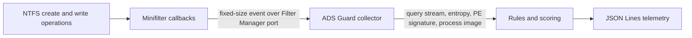

# NTFS ADS Guard

NTFS ADS Guard is a Windows minifilter and companion collector for identifying and recording named NTFS streams. It reports stream opens, creates, and successful writes, then enriches events in user mode with size, entropy, PE signature, process metadata, rule decisions, and JSONL telemetry.

## Project layout

```text
driver/       WDK minifilter and Filter Manager communication port
collector/    C++17 service-style console collector
config/       Allow-list and scoring settings
harness/      Benign ADS validation script
```

## Data flow



The driver reports normalized file and stream names, operation, requestor PID, timestamp, and observed stream size. A successful create callback reporting `FILE_OPENED` is classified as `open`; other successful create dispositions are classified as `create`. This follows the file system completion status and does not expose the original API call or prove that bytes changed. Successful write completions are queued to a PASSIVE_LEVEL worker before querying the stream. Paging writes are excluded, and a write can be missed if Filter Manager cannot safely queue the completion. Size-query failure is recorded as an NTSTATUS and a null size. The collector performs bounded content inspection outside the kernel, resolves the process image where permissions allow, applies the allow-list and rules, and emits one JSON object per received event. Content access failures are marked `unavailable` or `partial`, with an error code, instead of being reported as a clean scan. Events generated by the collector's own stream opens are discarded before inspection to prevent recursive observations.

## Build

Requirements: Windows 10 or 11 x64, Visual Studio 2022 with Desktop C++ workload, Windows Driver Kit matching the installed SDK, and CMake 3.20 or newer.

Build the user-mode collector:

```powershell
cmake -S collector -B build/collector -A x64
cmake --build build/collector --config Release
```

Open `driver/AdsGuard.vcxproj` in Visual Studio with the WDK installed, select x64 and a test configuration, then build. The driver project targets the Windows Driver Kit and is not built by the portable CMake project.

## Load for local development

Driver installation changes kernel state and requires administrator access. Use a disposable Windows VM. Enable Windows test signing from an elevated prompt, reboot, install the built `.inf` with `pnputil`, and start the `AdsGuard` minifilter service. The driver uses altitude `385250`, reserved here for development; obtain an assigned altitude before production deployment. Remove the package and service after testing and return test-signing settings to their prior state.

Install the minifilter package with `rundll32.exe setupapi.dll,InstallHinfSection DefaultInstall 132 .\AdsGuard.inf`, then attach it with `fltmc load AdsGuard`. Start `ads-guard-collector.exe --config config\rules.json --output events.jsonl` elevated so it can connect to the Filter Manager port and inspect protected process metadata. The collector connects to the kernel port named `\AdsGuardPort` through Filter Manager's communication port API.

## Example event

```json
{"schema_version":1,"timestamp":"2026-11-16T12:00:00.000Z","operation":"write","process_id":4321,"process":"C:\\Tools\\writer.exe","process_available":true,"file":"C:\\Users\\Public\\report.txt","stream":"C:\\Users\\Public\\report.txt:payload.bin:$DATA","size":4096,"size_query_status":0,"inspection_status":"complete","inspection_bytes":4096,"inspection_error":0,"entropy":7.12,"pe_header":false,"path_truncated":false,"allowlisted":false,"score":35,"severity":"low","reasons":["non_default_named_stream","high_entropy"]}
```

## Detection logic

The default rules suppress `Zone.Identifier` and permit additional stream suffixes and process image paths. Non-default named streams add a baseline score. PE headers, high entropy, executable-looking suffixes, and streams attached to Windows system binaries add score. Severity thresholds and entropy cutoff are configurable. Scores describe suspiciousness for triage; they are not proof of maliciousness.

Configuration is parsed as strict UTF-8 JSON. Malformed JSON, duplicate keys, unknown properties, missing required values, invalid numeric ranges, or unordered severity thresholds stop collector startup with an error.

Validate configuration without connecting to a running driver:

```powershell
build\collector\Release\ads-guard-collector.exe --check-config --config config\rules.json
pwsh -File collector\tests\config_validation.ps1 -Exe build\collector\Release\ads-guard-collector.exe -ValidConfig config\rules.json
```

## Validation

Run `harness/create_benign_ads.ps1` in a disposable test directory. It creates a small text stream, a `Zone.Identifier` stream, and a non-runnable synthetic PE-signature stream on a test text file. This exercises allow-list suppression, ordinary stream scoring, and the PE-header rule without creating an executable payload or altering system files.

## Limitations and tuning

- The collector has a Windows CI build. A complete WDK driver build and runtime validation require Visual Studio with the matching WDK; no driver was loaded during this review.
- The collector drops events caused by its own process. Deferred write notifications are best effort: paging I/O is excluded and Filter Manager may reject a completion when it cannot safely queue it.
- The minifilter sends events with a bounded timeout. If the collector is disconnected or not waiting for messages, events can be dropped; no persistent kernel queue is maintained.
- Minifilter callbacks observe file-system operations, not the identity of the original user-mode API or syscall.
- The first event can precede a completed write; post-write events report the current size, but a later write may change the content. Treat telemetry as a point-in-time observation.
- Enrichment can fail when the collector lacks access, a process exits, a file is renamed/deleted, or the stream changes between notification and inspection.
- Entropy and PE signatures are heuristics. Tune thresholds with representative benign workloads, and add known-good stream or process entries in `config/rules.json`.
- Network file systems and volumes not attached by the filter are outside coverage. The driver intentionally emits bounded paths; very long paths are truncated and marked.
- This is a development reference implementation. Production use requires signed deployment, assigned altitude, compatibility review, load/unload testing, and operational monitoring.

## Windows driver API references

- [Postoperation callback IRQL and draining rules](https://learn.microsoft.com/en-us/windows-hardware/drivers/ddi/content/fltkernel/nc-fltkernel-pflt_post_operation_callback)
- [Queueing a deferred I/O completion](https://learn.microsoft.com/en-us/windows-hardware/drivers/ddi/fltkernel/nf-fltkernel-fltqueuedeferredioworkitem)
- [FltQueryInformationFile signature and PASSIVE_LEVEL requirement](https://learn.microsoft.com/en-us/windows-hardware/drivers/ddi/fltkernel/nf-fltkernel-fltqueryinformationfile)
- [Requestor process ID](https://learn.microsoft.com/en-us/windows-hardware/drivers/ddi/fltkernel/nf-fltkernel-fltgetrequestorprocessid)

## License

MIT. See `LICENSE`.
