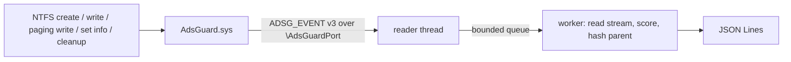

# NTFS ADS Guard

A Windows minifilter and a user-mode collector that record activity on NTFS alternate data streams (named `$DATA` streams) as JSON Lines. Each record says which process touched which stream, how (handle write, mapped-view write, size change), how long the handle was open, what the content looks like (entropy, PE header, SHA-256), and a configurable score. Scored events also carry a hash of the host file.

This is a lab project for detection engineering. It is not signed, uses a development-only altitude, and has not been load tested. Run the driver only in a disposable VM.

## Layout

```text
driver/      AdsGuard.sys minifilter, INF, protocol header, WDK project
collector/   ads-guard-collector.exe (C++17), unit tests, test scripts
config/      rules.json: allow-lists, weights, thresholds
harness/     script that creates benign test streams
tools/       verifier.ps1: Driver Verifier on and off in a test VM
docs/        DRIVER-LOAD.md, VERIFIER.md, ALTITUDE.md
```

## How it works



**Driver** (`driver/AdsGuard.c`, attaches to NTFS volumes only)

| Callback | IRQL | What it does |
| --- | --- | --- |
| PreCreate | PASSIVE | Skips paging file and volume opens, the collector's own process, and any name without a colon (opens by file ID and empty relative reopens still go through). |
| PostCreate | PASSIVE | Requires `STATUS_SUCCESS` (so `STATUS_REPARSE` is ignored) and a named `$DATA` stream (`:$I30:$INDEX_ALLOCATION` and `::$DATA` are not). Emits `open`, `create` or `overwrite` from `IoStatus.Information`. For handles opened with write access, attaches a stream handle context (open time, writer, byte count) and makes sure the stream has a stream context (cached name, last write-capable opener). |
| PreWrite | <= APC | Non-paging: looks up the handle context and records the first writing process (referenced). Paging: skips lazy writer flushes (`FSRTL_CACHE_TOP_LEVEL_IRP`) and looks up the stream context. |
| PostWrite | <= DISPATCH | Interlocked byte counts and first/last write times only. For paging writes, queues one generic work item per burst. |
| Paging work item | PASSIVE | Emits `write` with `write_source` `paging` from the name cached in the stream context. |
| PreSetInformation | PASSIVE | `FileEndOfFileInformation` (not `AdvanceOnly`) and `FileAllocationInformation` on handles with a context. Synchronized, so the post callback runs in the caller's thread. |
| PostSetInformation | PASSIVE (checked) | Emits `set_size` with the requested size. Counted as dropped if it ever runs above PASSIVE_LEVEL. |
| PreCleanup | PASSIVE | If the handle wrote data, emits one `write` event with `write_source` `handle`, the total bytes, and the open, first write and last write times. |

Name and size queries only happen at PASSIVE_LEVEL. The only deferred work is the paging write report, which uses a cached name and does not query the file system. Each event carries the process ID, process start time and image path (`SeLocateProcessImageName`), the normalized name (opened name as a fallback, flagged), the stream size or the NTSTATUS of the failed size query, the requested access mask, and a `KeQuerySystemTimePrecise` timestamp.

**Delivery.** The port's security descriptor comes from `FltBuildDefaultSecurityDescriptor` (SYSTEM and Administrators only) and allows one connection. `FltSendMessage` waits at most 10 ms. Anything not delivered while a collector is connected is counted, and the count rides on the next delivered event as `DroppedEvents`. When no collector is connected nothing is sent or counted. I/O from the connected collector's process is skipped in the driver, so inspecting a stream does not generate new events.

**Collector.** A reader thread drains the port into a bounded queue (`queue_capacity`); overflow is counted. The worker opens the stream through `\\?\GLOBALROOT` plus the NT path, retries briefly on sharing violations, reads up to `stream_size_limit_bytes`, and computes byte entropy, an MZ/PE check with bounds-checked `e_lfanew`, and SHA-256 (only when it reached EOF). When the score reaches the `low` threshold, it also hashes the host file's default stream if it is no larger than `parent_hash_max_bytes`. Paths the driver had to truncate are not opened.

**Protocol.** `driver/Protocol.h` defines `ADSG_EVENT` version 3 with fixed packing and build-time size and offset checks in both the driver and the collector. The collector rejects any other version or size and writes a `collector_error` record.

## Build

Collector (Visual Studio 2022 or later with the C++ workload, CMake 3.20+):

```powershell
cmake -S collector -B build/collector -A x64
cmake --build build/collector --config Release
ctest --test-dir build/collector -C Release --output-on-failure
```

Driver: open `driver/AdsGuard.vcxproj` in Visual Studio with the WDK installed and build `Release|x64`. Or restore the WDK NuGet packages first, as CI does:

```powershell
nuget restore driver/packages.config -PackagesDirectory driver/packages
msbuild driver/AdsGuard.vcxproj -p:Configuration=Release -p:Platform=x64
```

The build runs InfVerif, compiles at `/W4 /WX`, and writes a test-signed package (`AdsGuard.sys`, `AdsGuard.inf`, `adsguard.cat`) to `driver/x64/Release/AdsGuard/`. The driver uses `ExAllocatePool2`, so it needs Windows 10 version 2004 or later.

CI also rebuilds the driver with Code Analysis (`/analyze`, WDK `DriverRecommendedRules`, warnings fail the build) and uploads the test-signed package and the collector as artifacts. Static Driver Verifier is not run: it is not shipped in WDKs after build 26017. See [docs/VERIFIER.md](docs/VERIFIER.md).

## Try it without the driver

`--scan` runs the same inspection and scoring on streams that already exist:

```powershell
pwsh harness/create_benign_ads.ps1 -Directory $env:TEMP\ads-test
build\collector\Release\ads-guard-collector.exe --scan $env:TEMP\ads-test --output -
```

The harness creates a short text stream, a `Zone.Identifier` stream, and a non-runnable stream with an MZ/PE signature over random bytes. `collector/tests/scan_test.ps1` runs this and checks the results.

## Run with the driver (test VM only)

[docs/DRIVER-LOAD.md](docs/DRIVER-LOAD.md) is the full walkthrough: Hyper-V or VMware setup, test signing, INF or `sc.exe` install, `fltmc` checks, a workload that produces every event type, Driver Verifier, and removal. The short version:

1. Enable test signing (`bcdedit /set testsigning on`) and reboot. Note the previous setting so you can restore it.
2. Copy the `driver/x64/Release/AdsGuard/` package folder to the VM.
3. Install and load from an elevated prompt:
   ```powershell
   RUNDLL32.EXE SETUPAPI.DLL,InstallHinfSection DefaultInstall 132 .\AdsGuard.inf
   fltmc load AdsGuard
   fltmc instances -f AdsGuard
   ```
4. Start the collector elevated:
   ```powershell
   ads-guard-collector.exe --config config\rules.json --output events.jsonl
   ```
5. Remove it afterwards: stop the collector, `fltmc unload AdsGuard`, run `RUNDLL32.EXE SETUPAPI.DLL,InstallHinfSection DefaultUninstall 132 .\AdsGuard.inf`, and restore the test-signing setting.

The altitude in the INF, 389992, is a **development-only** value in the Activity Monitor range (360000 to 389999). It is not assigned to this project. See [docs/ALTITUDE.md](docs/ALTITUDE.md) for why it was picked and how to request a permanent one.

## Output

One JSON object per line. `record_type` is one of:

- `ads_event`: one stream observation.
- `events_lost`: `source` is `driver` (messages the driver could not deliver) or `collector_queue` (queue overflow), with a `count`.
- `collector_error`: protocol mismatch, port failure, scan failure, or processing error, with `detail`.

Example `ads_event` (wrapped for reading):

```json
{"record_type":"ads_event","schema_version":3,"collected_at":"2026-11-16T12:00:00.0154321Z",
 "timestamp":"2026-11-16T12:00:00.0123456Z","operation":"write",
 "process_id":4321,"process_create_time":"2026-11-16T11:58:10.5000000Z",
 "process":"C:\\Tools\\writer.exe","process_source":"kernel",
 "file":"C:\\Users\\Public\\report.txt","stream":"C:\\Users\\Public\\report.txt:payload.bin",
 "stream_name":"payload.bin","desired_access":"0x0012019F","bytes_written":4096,
 "size":4096,"size_query_status":"0x00000000",
 "inspection_status":"complete","inspection_bytes":4096,"inspection_error":0,
 "entropy":7.9512,"pe_header":true,"sha256":"<64 hex chars>","sha256_status":"complete",
 "path_truncated":false,"name_form":"normalized","writer_differs":false,
 "write_source":"handle","handle_opened_at":"2026-11-16T11:59:58.2000000Z",
 "first_write_at":"2026-11-16T11:59:58.2100000Z","last_write_at":"2026-11-16T11:59:59.9000000Z",
 "handle_open_ms":1812.346,"first_write_to_cleanup_ms":1802.346,
 "set_size_class":null,"requested_size":null,
 "parent_size":20480,"parent_sha256":"<64 hex chars>","parent_sha256_status":"complete","parent_error":0,
 "allowlisted":false,"score":85,"severity":"high",
 "reasons":["non_default_named_stream","pe_header","high_entropy"]}
```

Every key is always present. `null` means the value could not be obtained, and a status field says why:

| Field | Values |
| --- | --- |
| `process_source` | `kernel`, `kernel_truncated`, `user_mode` (driver had no image, start time matched), `pid_reused`, `unavailable`, `not_applicable` (scan) |
| `inspection_status` | `complete`, `size_limit`, `partial` (read error after some bytes), `unavailable` (open or first read failed, see `inspection_error`), `skipped_path_truncated` |
| `sha256_status` | `complete`, `skipped_incomplete`, `unavailable`, `error` |
| `pe_header` | `true`, `false`, or `null` when the bytes needed were not read |
| `entropy` | `null` below `entropy_min_bytes` or when nothing was read |
| `operation` | `open`, `create`, `overwrite`, `write`, `set_size`, `scan` |
| `write_source` | `handle` (non-paging writes on one handle, reported at cleanup), `paging` (writes through a mapped view, reported shortly after the mapped page writer flushes them), `null` for other operations |
| `name_form` | `normalized`, `opened`, `cached` (paging writes: the name from the first write-capable open) |
| `handle_open_ms`, `first_write_to_cleanup_ms` | Handle writes only: cleanup time minus open time, and minus the first write. A large `first_write_to_cleanup_ms` means the write was reported late because the handle stayed open. |
| `set_size_class`, `requested_size` | `set_size` only: `end_of_file` (SetEndOfFile, `SetLength`) or `allocation`, and the requested value in bytes |
| `parent_sha256_status` | `complete`, `not_scored` (below the `low` threshold), `disabled`, `skipped_size_limit`, `not_a_file` (stream on a directory), `skipped_path_truncated`, `unavailable` (see `parent_error`), `error` |

## Scoring and tuning

All settings in `config/rules.json` are required. The file is strict JSON: duplicate keys, unknown keys, wrong types and out-of-range values stop the collector at startup. Check a file with `--check-config`.

| Setting | Meaning |
| --- | --- |
| `allow_stream_names` | Exact stream names, case-insensitive (`Zone.Identifier`, not `:Zone.Identifier`). |
| `allow_process_paths` | Exact image paths, case-insensitive. |
| `executable_extensions` | Stream name endings that add `executable_extension`. |
| `system_host_prefixes` | Host file prefixes that add `system_binary_host`. |
| `entropy_threshold`, `entropy_min_bytes` | High-entropy cutoff in bits per byte and the minimum bytes before entropy is reported. |
| `stream_size_limit_bytes` | Read limit per stream. |
| `queue_capacity` | Collector queue size before events are dropped and counted. |
| `parent_hash_max_bytes` | Largest host file (default stream) hashed for a scored event. Default 8388608 (8 MiB); 0 turns it off. |
| `weights`, `thresholds` | Points per finding and the `low` / `medium` / `high` cutoffs. |

An allow-list match removes the name-based points (named stream, executable extension, system host) and adds `allowlisted_stream_name` or `allowlisted_process`. PE header and high entropy still score, so an allowed name or tool cannot hide a payload without showing up.

Tuning: run the collector on a representative machine for a while, sort the output by `stream_name` and `process`, and add the expected ones (backup agents, browsers writing `Zone.Identifier`, sync clients) to the allow-lists. Raise `entropy_threshold` if compressed or encrypted data in streams is normal for you. Scores rank events for triage; they are not verdicts.

## Limitations

- The driver has been compiled, run through Code Analysis and InfVerif in CI, but never loaded. IRQL, context and unload handling follow the Filter Manager documentation and are untested until someone runs [docs/DRIVER-LOAD.md](docs/DRIVER-LOAD.md) with Driver Verifier on.
- The altitude, 389992, is a development value that is not assigned to this project. See [docs/ALTITUDE.md](docs/ALTITUDE.md).
- Paging writes are attributed to the last process that opened the stream with write access, not to the thread that dirtied the page; the mapped page writer has no such link. The name is the one cached at the first write-capable open, so a later rename is not reflected (`name_form` `cached`). Paging writes on streams that were never opened for write while the driver was loaded are not seen.
- Lazy writer flushes are told apart from mapped-view writes by the `FSRTL_CACHE_TOP_LEVEL_IRP` marker. Under memory pressure the mapped page writer can also flush pages the cache manager dirtied, so a cached handle write can show up a second time as a `paging` write.
- `set_size` covers `FileEndOfFileInformation` and `FileAllocationInformation` through `NtSetInformationFile`. `SetFileValidData` and NTFS internal size updates are not reported.
- `handle` writes are reported at cleanup, so long-lived handles report late. `first_write_to_cleanup_ms` measures that delay. Content is read after the event, so it can differ from what was written.
- `writer_differs` marks handles closed by a different process than the first writer (handle duplication or inheritance). Only the first writer is recorded.
- Delivery is best effort: 10 ms per message, then counted as dropped. There is no persistent kernel queue.
- Names are taken when the event is built. Renames between the event and inspection make inspection fail, which shows up as `unavailable`.
- Only local NTFS volumes are covered. ReFS, FAT and network file systems are not attached.
- The user-mode fallback for process images runs only when the kernel lookup fails, and it is still racy for processes that exit quickly.
- Streams larger than `stream_size_limit_bytes` get entropy and PE results from the first part only and no hash. Host files larger than `parent_hash_max_bytes` are not hashed, and the host is hashed after the event, so it can have changed.

## References

- [Writing postoperation callback routines](https://learn.microsoft.com/windows-hardware/drivers/ifs/writing-postoperation-callback-routines)
- [FltSendMessage](https://learn.microsoft.com/windows-hardware/drivers/ddi/fltkernel/nf-fltkernel-fltsendmessage)
- [FltBuildDefaultSecurityDescriptor](https://learn.microsoft.com/windows-hardware/drivers/ddi/fltkernel/nf-fltkernel-fltbuilddefaultsecuritydescriptor)
- [Stream handle contexts](https://learn.microsoft.com/windows-hardware/drivers/ifs/managing-contexts)
- [SeLocateProcessImageName](https://learn.microsoft.com/windows-hardware/drivers/ddi/ntifs/nf-ntifs-selocateprocessimagename)
- [Load order groups and altitudes for minifilter drivers](https://learn.microsoft.com/windows-hardware/drivers/ifs/load-order-groups-and-altitudes-for-minifilter-drivers)
- [FltQueueGenericWorkItem](https://learn.microsoft.com/windows-hardware/drivers/ddi/fltkernel/nf-fltkernel-fltqueuegenericworkitem)
- [Driver Verifier options and rule classes](https://learn.microsoft.com/windows-hardware/drivers/devtest/driver-verifier-options)

## License

MIT. See `LICENSE`.
