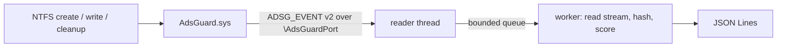

# NTFS ADS Guard

A Windows minifilter and a user-mode collector that record activity on NTFS alternate data streams (named `$DATA` streams) as JSON Lines. Each record says which process touched which stream, how big it is, what the first bytes look like (entropy, PE header, SHA-256), and a configurable score.

This is a lab project for detection engineering. It is not signed, has no assigned altitude, and has not been load tested. Run the driver only in a disposable VM.

## Layout

```text
driver/      AdsGuard.sys minifilter, INF, protocol header, WDK project
collector/   ads-guard-collector.exe (C++17), unit tests, test scripts
config/      rules.json: allow-lists, weights, thresholds
harness/     script that creates benign test streams
```

## How it works



**Driver** (`driver/AdsGuard.c`, attaches to NTFS volumes only)

| Callback | IRQL | What it does |
| --- | --- | --- |
| PreCreate | PASSIVE | Skips paging file and volume opens, the collector's own process, and any name without a colon (opens by file ID and empty relative reopens still go through). |
| PostCreate | PASSIVE | Requires `STATUS_SUCCESS` (so `STATUS_REPARSE` is ignored) and a named `$DATA` stream (`:$I30:$INDEX_ALLOCATION` and `::$DATA` are not). Emits `open`, `create` or `overwrite` from `IoStatus.Information`. Attaches a stream handle context when the handle was opened with write access. |
| PreWrite | <= APC | Looks up the handle context and records the first writing process (referenced). |
| PostWrite | <= DISPATCH | Interlocked byte count and "written" flag only. Paging I/O is not registered. |
| PreCleanup | PASSIVE | If the handle wrote data, emits one `write` event with the total bytes written. |

Name and size queries only happen at PASSIVE_LEVEL, so the write path needs no deferred work items. Each event carries the process ID, process start time and image path (`SeLocateProcessImageName`), the normalized name (opened name as a fallback, flagged), the stream size or the NTSTATUS of the failed size query, the requested access mask, and a `KeQuerySystemTimePrecise` timestamp.

**Delivery.** The port's security descriptor comes from `FltBuildDefaultSecurityDescriptor` (SYSTEM and Administrators only) and allows one connection. `FltSendMessage` waits at most 10 ms. Anything not delivered while a collector is connected is counted, and the count rides on the next delivered event as `DroppedEvents`. When no collector is connected nothing is sent or counted. I/O from the connected collector's process is skipped in the driver, so inspecting a stream does not generate new events.

**Collector.** A reader thread drains the port into a bounded queue (`queue_capacity`); overflow is counted. The worker opens the stream through `\\?\GLOBALROOT` plus the NT path, retries briefly on sharing violations, reads up to `stream_size_limit_bytes`, and computes byte entropy, an MZ/PE check with bounds-checked `e_lfanew`, and SHA-256 (only when it reached EOF). Paths the driver had to truncate are not opened.

**Protocol.** `driver/Protocol.h` defines `ADSG_EVENT` version 2 with fixed packing and build-time size and offset checks in both the driver and the collector. The collector rejects any other version or size and writes a `collector_error` record.

## Build

Collector (Visual Studio 2022 or later with the C++ workload, CMake 3.20+):

```powershell
cmake -S collector -B build/collector -A x64
cmake --build build/collector --config Release
ctest --test-dir build/collector -C Release --output-on-failure
```

Driver: open `driver/AdsGuard.vcxproj` in Visual Studio with the WDK installed and build `Release|x64`. Or restore the WDK NuGet packages first, as CI does:

```powershell
nuget restore driver/packages.config -PackagesDirectory driver/packages
msbuild driver/AdsGuard.vcxproj -p:Configuration=Release -p:Platform=x64
```

The build runs InfVerif, compiles at `/W4 /WX`, and writes a test-signed package (`AdsGuard.sys`, `AdsGuard.inf`, `adsguard.cat`) to `driver/x64/Release/AdsGuard/`. The driver uses `ExAllocatePool2`, so it needs Windows 10 version 2004 or later.

## Try it without the driver

`--scan` runs the same inspection and scoring on streams that already exist:

```powershell
pwsh harness/create_benign_ads.ps1 -Directory $env:TEMP\ads-test
build\collector\Release\ads-guard-collector.exe --scan $env:TEMP\ads-test --output -
```

The harness creates a short text stream, a `Zone.Identifier` stream, and a non-runnable stream with an MZ/PE signature over random bytes. `collector/tests/scan_test.ps1` runs this and checks the results.

## Run with the driver (test VM only)

1. Enable test signing (`bcdedit /set testsigning on`) and reboot. Note the previous setting so you can restore it.
2. Copy the `driver/x64/Release/AdsGuard/` package folder to the VM.
3. Install and load from an elevated prompt:
   ```powershell
   RUNDLL32.EXE SETUPAPI.DLL,InstallHinfSection DefaultInstall 132 .\AdsGuard.inf
   fltmc load AdsGuard
   fltmc instances -f AdsGuard
   ```
4. Start the collector elevated:
   ```powershell
   ads-guard-collector.exe --config config\rules.json --output events.jsonl
   ```
5. Remove it afterwards: stop the collector, `fltmc unload AdsGuard`, run `RUNDLL32.EXE SETUPAPI.DLL,InstallHinfSection DefaultUninstall 132 .\AdsGuard.inf`, and restore the test-signing setting.

The altitude in the INF, 385250, is a placeholder inside the Activity Monitor range (360000 to 389999). Request an assigned altitude from Microsoft before using it anywhere else.

## Output

One JSON object per line. `record_type` is one of:

- `ads_event`: one stream observation.
- `events_lost`: `source` is `driver` (messages the driver could not deliver) or `collector_queue` (queue overflow), with a `count`.
- `collector_error`: protocol mismatch, port failure, scan failure, or processing error, with `detail`.

Example `ads_event` (wrapped for reading):

```json
{"record_type":"ads_event","schema_version":2,"collected_at":"2026-11-16T12:00:00.0154321Z",
 "timestamp":"2026-11-16T12:00:00.0123456Z","operation":"write",
 "process_id":4321,"process_create_time":"2026-11-16T11:58:10.5000000Z",
 "process":"C:\\Tools\\writer.exe","process_source":"kernel",
 "file":"C:\\Users\\Public\\report.txt","stream":"C:\\Users\\Public\\report.txt:payload.bin",
 "stream_name":"payload.bin","desired_access":"0x0012019F","bytes_written":4096,
 "size":4096,"size_query_status":"0x00000000",
 "inspection_status":"complete","inspection_bytes":4096,"inspection_error":0,
 "entropy":7.9512,"pe_header":true,"sha256":"<64 hex chars>","sha256_status":"complete",
 "path_truncated":false,"name_form":"normalized","writer_differs":false,
 "allowlisted":false,"score":85,"severity":"high",
 "reasons":["non_default_named_stream","pe_header","high_entropy"]}
```

Every key is always present. `null` means the value could not be obtained, and a status field says why:

| Field | Values |
| --- | --- |
| `process_source` | `kernel`, `kernel_truncated`, `user_mode` (driver had no image, start time matched), `pid_reused`, `unavailable`, `not_applicable` (scan) |
| `inspection_status` | `complete`, `size_limit`, `partial` (read error after some bytes), `unavailable` (open or first read failed, see `inspection_error`), `skipped_path_truncated` |
| `sha256_status` | `complete`, `skipped_incomplete`, `unavailable`, `error` |
| `pe_header` | `true`, `false`, or `null` when the bytes needed were not read |
| `entropy` | `null` below `entropy_min_bytes` or when nothing was read |

## Scoring and tuning

All settings in `config/rules.json` are required. The file is strict JSON: duplicate keys, unknown keys, wrong types and out-of-range values stop the collector at startup. Check a file with `--check-config`.

| Setting | Meaning |
| --- | --- |
| `allow_stream_names` | Exact stream names, case-insensitive (`Zone.Identifier`, not `:Zone.Identifier`). |
| `allow_process_paths` | Exact image paths, case-insensitive. |
| `executable_extensions` | Stream name endings that add `executable_extension`. |
| `system_host_prefixes` | Host file prefixes that add `system_binary_host`. |
| `entropy_threshold`, `entropy_min_bytes` | High-entropy cutoff in bits per byte and the minimum bytes before entropy is reported. |
| `stream_size_limit_bytes` | Read limit per stream. |
| `queue_capacity` | Collector queue size before events are dropped and counted. |
| `weights`, `thresholds` | Points per finding and the `low` / `medium` / `high` cutoffs. |

An allow-list match removes the name-based points (named stream, executable extension, system host) and adds `allowlisted_stream_name` or `allowlisted_process`. PE header and high entropy still score, so an allowed name or tool cannot hide a payload without showing up.

Tuning: run the collector on a representative machine for a while, sort the output by `stream_name` and `process`, and add the expected ones (backup agents, browsers writing `Zone.Identifier`, sync clients) to the allow-lists. Raise `entropy_threshold` if compressed or encrypted data in streams is normal for you. Scores rank events for triage; they are not verdicts.

## Limitations

- The driver has been compiled in CI but never loaded or run. Its IRQL, context and unload handling follow the Filter Manager documentation but are untested.
- Writes through memory-mapped views reach NTFS as paging I/O, which is not monitored. Changes made with `SetEndOfFile` or other set-information calls are not reported as writes.
- A `write` event is sent when the writing handle is cleaned up, so long-lived handles report late. Content is read after the event, so it can differ from what was written.
- `writer_differs` marks handles closed by a different process than the first writer (handle duplication or inheritance). Only the first writer is recorded.
- Delivery is best effort: 10 ms per message, then counted as dropped. There is no persistent kernel queue.
- Names are taken when the event is built. Renames between the event and inspection make inspection fail, which shows up as `unavailable`.
- Only local NTFS volumes are covered. ReFS, FAT and network file systems are not attached.
- The user-mode fallback for process images runs only when the kernel lookup fails, and it is still racy for processes that exit quickly.
- Streams larger than `stream_size_limit_bytes` get entropy and PE results from the first part only and no hash. The parent file is not hashed.

## References

- [Writing postoperation callback routines](https://learn.microsoft.com/windows-hardware/drivers/ifs/writing-postoperation-callback-routines)
- [FltSendMessage](https://learn.microsoft.com/windows-hardware/drivers/ddi/fltkernel/nf-fltkernel-fltsendmessage)
- [FltBuildDefaultSecurityDescriptor](https://learn.microsoft.com/windows-hardware/drivers/ddi/fltkernel/nf-fltkernel-fltbuilddefaultsecuritydescriptor)
- [Stream handle contexts](https://learn.microsoft.com/windows-hardware/drivers/ifs/managing-contexts)
- [SeLocateProcessImageName](https://learn.microsoft.com/windows-hardware/drivers/ddi/ntifs/nf-ntifs-selocateprocessimagename)
- [Load order groups and altitudes for minifilter drivers](https://learn.microsoft.com/windows-hardware/drivers/ifs/load-order-groups-and-altitudes-for-minifilter-drivers)

## License

MIT. See `LICENSE`.
